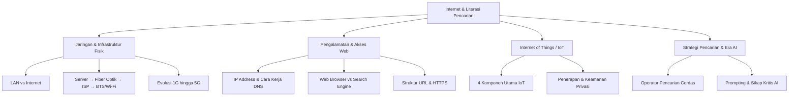
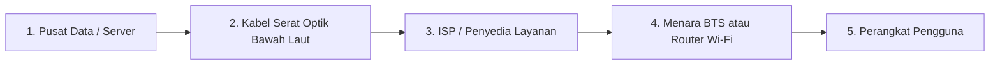
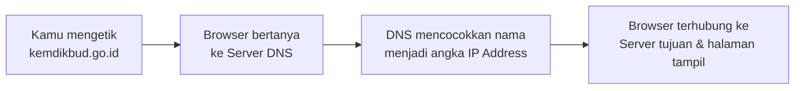
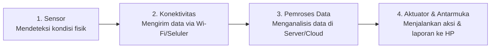

# Jaringan Komputer, Internet, IoT & Literasi Pencarian

> **Kelas 7 • Semester 2 • Elemen: Literasi Digital • Alokasi Waktu: 12 JP**  
> **Tujuan Pembelajaran:** Memahami perbedaan jaringan lokal dan internet, infrastruktur fisik dan pengalamatan internet (IP & DNS), perkembangan jaringan seluler (1G–5G), penerapan dan keamanan *Internet of Things* (IoT), perbedaan *Web Browser* dan *Search Engine*, serta teknik pencarian informasi yang efektif dan kritis di era AI.  
> **Dimensi Profil Lulusan:** Mandiri, Bernalar Kritis.

---

## Peta Konsep Bab Ini



---

## 1. Pemantik: Mengapa Internet Bisa "Mati" Saat Kabel Putus?

Pernahkah kamu mengalami kejadian ketika jaringan Wi-Fi atau kuota internet tiba-tiba melambat serentak di satu kota, lalu muncul berita: *"Akses internet terganggu akibat putusnya kabel bawah laut"*?

Sekilas terdengar aneh. Kita menggunakan HP tanpa kabel sama sekali—lalu apa hubungannya dengan kabel di dasar laut?

Di bab ini, kita akan membongkar rahasia di balik layar internet: bagaimana data melintasi samudra dalam hitungan milidetik, bagaimana benda-benda di sekitar kita bisa terhubung ke internet, hingga bagaimana cara bertanya kepada mesin pencari dan AI agar mendapatkan ilmu yang benar, bukan sekadar informasi cepat.

---

## 2. Jaringan Lokal (LAN) vs Internet

Sebelum memahami internet, kita perlu mengenal **jaringan komputer**—yaitu dua atau lebih perangkat (komputer, laptop, ponsel, *printer*) yang saling terhubung melalui kabel atau nirkabel (*wireless*) agar dapat bertukar data dan berbagi sumber daya.

Berdasarkan luas cakupannya, jaringan dibagi menjadi:
1. **LAN (*Local Area Network*) — Jaringan Lokal:** Mencakup area sempit seperti satu ruang laboratorium komputer, satu rumah, atau satu gedung sekolah. Komputer di lab bisa saling berkirim file dan mencetak ke satu *printer* bersama **meskipun tidak terhubung ke internet**.
2. **MAN (*Metropolitan Area Network*):** Menghubungkan beberapa jaringan lokal dalam satu wilayah kota (misalnya jaringan antar-kantor pemerintahan di Kota Solok).
3. **WAN (*Wide Area Network*):** Menghubungkan jaringan lintas kota, lintas pulau, hingga lintas negara.
4. **Internet (*Interconnected Network*):** Jaringan raksasa berskala global yang menyatukan jutaan jaringan LAN, MAN, dan WAN di seluruh dunia menjadi satu sistem komunikasi terbuka.

### Perbandingan Jaringan Lokal (LAN) dan Internet

| Aspek | Jaringan Lokal (LAN) | Internet |
| :--- | :--- | :--- |
| **Jangkauan** | Terbatas (ruangan, rumah, gedung sekolah). | Global (menghubungkan seluruh dunia). |
| **Pengelola** | Dikelola secara mandiri (pihak sekolah atau pemilik rumah). | Tidak dimiliki satu pihak; dikelola bersama oleh berbagai penyedia layanan dunia. |
| **Kecepatan & Stabilitas** | Sangat cepat dan stabil karena jarak perangkat berdekatan. | Dipengaruhi paket langganan, jarak ke pemancar, dan kepadatan trafik. |
| **Biaya Akses** | Tanpa biaya kuota bulanan untuk pertukaran data internal. | Memerlukan langganan paket data seluler atau Wi-Fi ke ISP. |
| **Contoh Nyata** | Ujian berbasis *server* lokal lab sekolah, berbagi *printer* kantor. | Membuka YouTube, mencari materi di Google, mengirim email, rapat daring. |

---

## 3. Infrastruktur Fisik Internet: Dari Server ke Layar Kita

> ❌ **Miskonsepsi yang Sering Terjadi:** Banyak orang mengira internet dipancarkan dari satelit luar angkasa.  
> ✅ **Faktanya:** Lebih dari **95% lalu lintas internet dunia** mengalir lewat **kabel serat optik (*fiber optic*) di darat dan dasar laut** karena jauh lebih cepat, stabil, dan murah dibanding satelit.

### Alur Perjalanan Data Internet



Mari pahami peran setiap stasiun dalam perjalanan data tersebut:

1. **Pusat Data (*Data Center / Server*):** Gedung berisi ribuan komputer berperforma tinggi yang menyala 24 jam nonstop untuk menyimpan website, foto, dokumen, dan video (misalnya *server* YouTube atau Google di Singapura atau Amerika Serikat).
2. **Kabel Serat Optik (*Fiber Optic*):** Kabel berbahan serat kaca sangat halus yang membawa data dalam bentuk **pulsa cahaya**. Kecepatannya mendekati kecepatan cahaya sehingga data dari benua lain bisa tiba dalam sepersekian detik.
3. **ISP (*Internet Service Provider*):** Perusahaan penyedia jasa layanan internet di daerah kita (seperti Telkomsel, IndiHome, XL, Indosat, Biznet). ISP menjadi "gerbang resmi" yang menghubungkan jaringan lokal masyarakat ke jaringan global.
4. **Pemancar Akhir (Menara BTS vs Router Wi-Fi):** Gerbang terakhir sebelum data masuk ke perangkat kita tanpa kabel.

| Aspek Pembanding | Menara BTS (*Base Transceiver Station*) | Router Wi-Fi |
| :--- | :--- | :--- |
| **Jenis Koneksi** | Sinyal seluler / kuota data (3G, 4G, 5G). | Sinyal nirkabel lokal (Wi-Fi). |
| **Jangkauan Sinyal** | Luas (beberapa ratus meter hingga beberapa kilometer di luar ruangan). | Terbatas (sekitar 10–30 meter di dalam rumah, kelas, atau gedung). |
| **Mobilitas Pengguna** | Bisa dipakai sambil berpindah tempat (di perjalanan/kendaraan). | Hanya aktif selama pengguna berada di sekitar area *router*. |
| **Sumber Sambungan** | Dikelola langsung oleh operator seluler. | Terhubung lewat kabel *fiber optic* ISP ke rumah/sekolah. |

5. **Perangkat Pengguna (*Client*):** HP, tablet, atau laptop yang memiliki antena penerima sinyal untuk meminta dan menampilkan data kepada kita.

### Analisis Gangguan Jalur Fisik
Karena seluruh rantai di atas saling bergantung, kerusakan di satu titik berdampak berbeda:
* **Router Wi-Fi sekolah mati listrik:** Hanya warga sekolah yang kehilangan akses Wi-Fi; pengguna kuota seluler di dekat sekolah tetap bisa mengakses internet.
* **Menara BTS mengalami gangguan:** Pengguna operator seluler tersebut di sekitar area BTS kehilangan sinyal, tetapi pengguna Wi-Fi kabel tetap lancar.
* **Kabel serat optik bawah laut putus (misalnya tersangkut jangkar kapal):** Akses ke *server* luar negeri di wilayah yang terdampak melambat drastis atau terputus (*down*) hingga ISP mengalihkan jalur (*rerouting*) atau memperbaiki kabelnya.

---

## 4. Evolusi Jaringan Seluler: Dari 1G hingga 5G

Huruf **"G"** pada jaringan seluler berarti ***Generation*** (generasi teknologi komunikasi nirkabel). Setiap generasi menghadirkan lompatan besar dalam kecepatan dan jenis data yang bisa dikirimkan:

| Generasi | Sifat Sinyal | Kemampuan Utama | Contoh Penggunaan di Masa Itu |
| :--- | :--- | :--- | :--- |
| **1G** | Analog | Hanya panggilan suara. | Ponsel berukuran besar; suara sering berisik, belum bisa SMS. |
| **2G** | Digital | Suara jernih + **SMS & MMS** + data sangat lambat. | Berkirim pesan teks singkat; internet baru sebatas teks ringan. |
| **3G** | Digital (Pita Lebar) | Akses internet *mobile* memadai. | Membuka halaman web di HP, email, dan panggilan video awal. |
| **4G (LTE)** | Digital Kecepatan Tinggi | Transfer data cepat dan stabil. | *Streaming* video HD, kelas daring (*Zoom/Meet*), media sosial, gim daring. |
| **5G** | Ultra Cepat & Latensi Sangat Rendah | Kecepatan sangat tinggi, jeda hampir nol, mampu menampung jutaan perangkat serentak. | Kendaraan otonom, telemedis (operasi jarak jauh), *smart city*, dan **IoT skala besar**. |

---

## 5. Pengalamatan di Internet: IP Address, DNS, dan URL

Bayangkan kamu mengirim paket kepada sahabatmu di luar kota. Paket tidak akan sampai tanpa **alamat rumah yang unik**. Di internet, mekanismenya persis sama:

### A. IP Address (*Internet Protocol Address*)
Setiap perangkat dan *server* yang terhubung ke internet memiliki "nomor rumah" unik berupa deretan angka yang disebut **IP Address**, contohnya: `142.250.193.206`. Nomor inilah yang dibaca komputer dan *router* agar data yang kamu minta tidak nyasar ke HP orang lain.

### B. DNS (*Domain Name System*) — "Buku Kontak Internet"
Manusia sulit menghafal puluhan deretan angka IP Address setiap hari. Karena itu, dibuatlah sistem **DNS** yang bekerja persis seperti **Buku Kontak di HP-mu**: kamu cukup mengetik nama *"Ummi"* di kontak, lalu HP otomatis memanggil nomor teleponnya.

Begini cara DNS bekerja di balik layar saat kamu mengetik `kemdikbud.go.id`:



### C. Membaca Struktur Alamat Web (URL) dan Keamanan HTTPS
Alamat lengkap sebuah halaman web disebut **URL (*Uniform Resource Locator*)**. Contoh:

```text
[https://www.kemdikbud.go.id/berita/pendidikan](https://www.kemdikbud.go.id/berita/pendidikan)
```

* **`https://`** → Protokol pengiriman data yang aman. Huruf **`s`** (*secure*)—biasanya ditandai ikon **gembok** di *browser*—menandakan data yang kamu kirim (seperti kata sandi) dienkripsi agar tidak mudah disadap, berbeda dengan `http://` biasa.
* **`kemdikbud.go.id`** → **Nama Domain**. Akhiran domain (*Top-Level Domain*) menunjukkan identitas pemilik situs:
  * `.go.id` → Lembaga resmi pemerintah Indonesia (misal: `solokkota.go.id`, `bps.go.id`)
  * `.sch.id` → Sekolah resmi di Indonesia
  * `.ac.id` / `.edu` → Perguruan tinggi / lembaga akademik
  * `.org` → Organisasi nirlaba
  * `.com` / `.co.id` → Situs umum atau perusahaan komersial

---

## 6. *Web Browser* vs *Search Engine*

Dua istilah ini paling sering tertukar dalam percakapan sehari-hari. Kuncinya: **satu berupa aplikasi di perangkatmu, satu lagi berupa situs web di internet**.

| Pembeda | *Web Browser* (Peramban Web) | *Search Engine* (Mesin Pencari) |
| :--- | :--- | :--- |
| **Wujud** | **Perangkat lunak aplikasi** yang diinstal di HP/laptop. | **Situs web khusus** yang diakses melalui internet. |
| **Fungsi Utama** | Membuka, membaca, dan menampilkan halaman web. | Mencarikan daftar halaman web yang sesuai dengan kata kunci pengguna. |
| **Analogi** | **Mobil / Kendaraan** untuk menjelajahi jalanan internet. | **Pustakawan / Pemandu** yang menunjukkan rak buku tempat informasi berada. |
| **Hubungan Kerja** | Kamu **harus membuka *Web Browser* dulu**... | ...baru bisa membuka dan menggunakan ***Search Engine***. |
| **Contoh** | Google Chrome, Mozilla Firefox, Microsoft Edge, Safari, Opera. | Google Search (`google.com`), Bing (`bing.com`), DuckDuckGo (`duckduckgo.com`), Yahoo. |

---

## 7. *Internet of Things* (IoT): Ketika Benda Ikut "Cerdas"

***Internet of Things* (IoT)** adalah konsep di mana benda-benda fisik sehari-hari (selain komputer dan HP) ditanami sensor, perangkat lunak, dan koneksi internet sehingga mampu mengumpulkan data, saling berkomunikasi, dan dikendalikan dari jarak jauh.

### 4 Komponen Utama Sistem IoT



1. **Sensor:** "Indra" perangkat yang menangkap perubahan fisik di lingkungan (suhu, kelembapan tanah, gerakan, cahaya, atau detak jantung).
2. **Konektivitas:** Jalur pengiriman data dari sensor ke internet (Wi-Fi, Bluetooth, atau jaringan seluler 4G/5G).
3. **Pemroses Data:** Otak digital (di *cloud* atau *server*) yang mengolah data mentah—misalnya memutuskan: *"Kelembapan tanah di bawah 30%, tanaman perlu disiram!"*
4. **Aktuator & Antarmuka Pengguna:** **Aktuator** adalah bagian yang melakukan tindakan nyata (menyalakan pompa air, menghidupkan alarm, mematikan lampu), sedangkan **Antarmuka Pengguna** adalah aplikasi di HP tempat pengguna melihat notifikasi atau memberi perintah manual.

### Penerapan IoT di Berbagai Bidang

| Bidang | Contoh Perangkat IoT | Manfaat Nyata |
| :--- | :--- | :--- |
| **Rumah Pintar (*Smart Home*)** | Lampu pintar, AC pintar, CCTV daring, kunci pintu pintar. | Menghemat listrik dan memantau keamanan rumah saat keluarga bepergian. |
| **Kesehatan** | Jam tangan pintar (*smartwatch*), sensor kadar gula darah daring. | Memantau detak jantung, kualitas tidur, dan memberi peringatan dini bila kondisi tubuh tidak normal. |
| **Pertanian (*Smart Farming*)** | Sensor kelembapan tanah & sistem penyiraman otomatis. | Membantu petani menghemat air dan menjaga kesuburan tanaman (seperti padi atau teh) secara tepat waktu. |
| **Lingkungan** | Sensor kualitas udara, alat pendeteksi dini ketinggian air sungai. | Memberi peringatan dini polusi atau potensi banjir kepada warga sekitar. |

### Risiko Privasi & Kebiasaan Aman Menggunakan IoT
Karena perangkat IoT terus mengumpulkan data (termasuk rekaman kamera CCTV atau lokasi rumah), perangkat yang tidak aman bisa diretas pihak tidak bertanggung jawab. Terapkan **4 kebiasaan aman IoT**:
* **Segera ganti kata sandi bawaan (*default password*)** saat pertama kali memasang perangkat (seperti CCTV atau *router* Wi-Fi).
* **Rutin melakukan pembaruan (*update software*)** agar celah keamanan perangkat tertutup.
* **Matikan fitur atau kamera yang tidak dipakai**, terutama di ruang pribadi keluarga.
* **Gunakan perangkat dari merek resmi** yang memiliki jaminan keamanan data, bukan produk bajakan tanpa identitas jelas.

---

## 8. Strategi Pencarian Efektif & Sikap Kritis di Era AI

### A. Menguasai Operator Pencarian (Google / Bing)
Daripada mengetik kalimat tanya yang panjang dan menghasilkan jutaan laman tidak relevan, gunakan **kata kunci inti** yang dipadukan dengan **4 operator pencarian** berikut:

| Operator | Cara Menulis | Fungsi | Contoh Penggunaan |
| :--- | :--- | :--- | :--- |
| **Tanda Kutip** (`"..."`) | Apit frasa di dalam tanda kutip | Mencari susunan kata yang **sama persis** urutannya. | `"Masjid Tuo Kayu Jao"` |
| **Tanda Minus** (`-`) | Tanpa spasi di depan kata | **Mengecualikan** kata yang tidak diinginkan dari hasil. | `jaguar -mobil -iklan` |
| **Operator `site:`** | `site:namadomain` | Membatasi pencarian **hanya di situs atau domain tertentu**. | `data penduduk solok site:bps.go.id` |
| **Operator `filetype:`** | `filetype:ekstensi` | Mencari **jenis file tertentu** (PDF, PPT, DOCX). | `modul berpikir komputasional filetype:pdf` |

> 💡 **Tips Kombinasi:** Kamu bisa menggabungkan beberapa operator sekaligus!  
> Contoh: `"sejarah minangkabau" -wikipedia site:ac.id filetype:pdf`  
> *(Artinya: cari dokumen PDF berisi frasa persis "sejarah minangkabau" dari situs kampus Indonesia, tanpa hasil Wikipedia).*

### B. *Search Engine* Tradisional vs Mesin Pencari Berbasis AI Generatif
Saat ini, selain mesin pencari tradisional, hadir pula **AI Generatif** (seperti Gemini dan ChatGPT) yang mampu merangkum informasi langsung menjadi jawaban terstruktur.

* **Kelebihan AI Generatif:** Cepat membantu memahami konsep sulit, membuat analogi sederhana, dan merangkum topik panjang.
* **Kelemahan AI Generatif (*Halusinasi AI*):** AI bekerja dengan memprediksi rangkaian kata; ia **bisa menghasilkan informasi yang terdengar sangat meyakinkan padahal keliru** (misalnya salah menyebut tahun sejarah, mengarang judul buku, atau keliru menghitung angka tertentu).

#### Rumus Menyusun *Prompt* (Perintah AI) yang Baik
Agar jawaban AI tepat guna untuk belajar, gunakan pola **4 unsur**:

$$\text{Prompt Efektif} = \text{Peran} + \text{Tugas} + \text{Target/Tingkat} + \text{Format}$$

* ❌ *Prompt lemah:* `"Jelaskan DNS"`
* ✅ *Prompt efektif:* `"Bertindaklah sebagai guru Informatika SMP (Peran). Jelaskan cara kerja DNS (Tugas) dengan analogi sederhana untuk siswa kelas 7 (Target) dalam bentuk 3 poin singkat dan 1 contoh nyata (Format)."`

#### Etika & Sikap Kritis Menggunakan AI
Dalam Islam, ketelitian menerima ilmu adalah bagian dari amanah dan *tabayyun*. Terapkan **3 prinsip bijak AI**:
1. **AI adalah asisten belajar, bukan pengganti otak kita:** Gunakan untuk berdiskusi dan memahami materi, bukan untuk menyalin mentah-mentah tugas (*copy-paste*) lalu mengakuinya sebagai karya sendiri.
2. **Wajib verifikasi silang:** Setiap fakta penting (angka, sejarah, dalil, kesehatan) yang berasal dari AI harus dicek ulang ke **buku pelajaran, guru, atau situs resmi** (`.go.id`, `.ac.id`).
3. **Jangan bagikan data pribadi:** Hindari mengetikkan alamat rumah, nomor telepon, atau data rahasia keluarga ke kolom obrolan AI.

---

## 9. Aktivitas Pembelajaran (Plugged & Unplugged)

### Aktivitas 1: Detektif Jalur & Buku Telepon DNS (*Plugged*)
1. Buka *Web Browser* di komputer lab/HP.
2. Ketikkan alamat IP `142.250.193.206` di bilah URL lalu tekan **Enter** untuk membuktikan bahwa situs web pada dasarnya dipanggil menggunakan angka IP Address.
3. Kunjungi `whoismyisp.org` dan catat nama **ISP** serta **IP Publik** yang sedang digunakan jaringan sekolah.
4. Uji kombinasi operator pencarian: cari 1 dokumen PDF resmi tentang keamanan internet dari situs pemerintah menggunakan `site:go.id` dan `filetype:pdf`.

### Aktivitas 2: Simulasi "Rantai Infrastruktur & Gangguan" (*Unplugged*)
1. Bentuk kelompok berisi 5 peran: **Server**, **Kabel Fiber Optik**, **ISP**, **Menara BTS / Router Wi-Fi**, dan **Pengguna (Client)**.
2. Simulasikan pengiriman "paket data" dari *Server* ke *Client*.
3. Diskusikan dua skenario:
   * *Skenario A:* Peran **Router Wi-Fi** keluar dari barisan → siapa saja yang terdampak?
   * *Skenario B:* Peran **Kabel Fiber Optik** keluar dari barisan → apa dampaknya bagi seluruh pengguna?

---

## 10. Cek Pemahaman Bertingkat (Latihan Mandiri)

Kerjakan di buku catatanmu terlebih dahulu, lalu buka bagian pembahasan untuk memeriksa jawabanmu.

### Soal 1 (Pemahaman Konsep — LAN vs Internet)
Di sebuah laboratorium komputer, seluruh 25 komputer siswa tetap bisa mengirim tugas ke komputer guru melalui folder bersama saat kabel internet sekolah sedang terputus. Jenis jaringan apa yang sedang bekerja di laboratorium tersebut, dan mengapa tetap bisa berjalan tanpa internet?

<details>
<summary><strong>👉 Lihat Pembahasan Soal 1</strong></summary>

Jaringan yang bekerja adalah **LAN (*Local Area Network*)** atau jaringan lokal. LAN tetap bisa berjalan tanpa internet karena seluruh komputer terhubung secara langsung di dalam satu area terbatas (gedung/ruangan yang sama) menggunakan kabel/switch lokal tanpa perlu keluar menuju ISP atau jaringan global.

</details>

### Soal 2 (Analisis Kasus — Infrastruktur & Pemancar Akhir)
Saat listrik di rumah Aisyah padam, koneksi Wi-Fi di rumahnya langsung mati. Namun, saat ia beralih menggunakan kuota data seluler di HP-nya, ia masih bisa membuka materi buku digital Informatika. Jelaskan mengapa hal ini bisa terjadi berdasarkan perbedaan **Router Wi-Fi** dan **Menara BTS**!

<details>
<summary><strong>👉 Lihat Pembahasan Soal 2</strong></summary>

**Router Wi-Fi** di rumah membutuhkan aliran listrik dari rumah tersebut dan jangkauannya terbatas di dalam rumah, sehingga langsung mati saat listrik rumah padam. Sementara itu, **Menara BTS** milik operator seluler memiliki jangkauan luas (hingga beberapa kilometer) dan umumnya dilengkapi baterai cadangan/genset tersendiri, sehingga sinyal seluler HP tetap aktif.

</details>

### Soal 3 (Penerapan — Komponen IoT)
Sebuah kebun teh di Alahan Panjang memasang alat penyiram pintar: jika tanah terlalu kering, sensor mengirim data lewat jaringan seluler ke *server*, lalu *server* memerintahkan keran air terbuka otomatis sekaligus mengirim laporan ke HP petani. Identifikasi keempat komponen IoT pada kasus tersebut!

<details>
<summary><strong>👉 Lihat Pembahasan Soal 3</strong></summary>

1. **Sensor:** Sensor kelembapan tanah yang mendeteksi kondisi tanah kering.
2. **Konektivitas:** Jaringan seluler yang mengirim data dari kebun ke *server*.
3. **Pemroses Data:** *Server* yang menganalisis angka kelembapan dan mengambil keputusan untuk menyiram.
4. **Aktuator & Antarmuka Pengguna:** Keran air otomatis (aktuator yang melakukan tindakan fisik) dan aplikasi laporan di HP petani (antarmuka pengguna).

</details>

### Soal 4 (HOTS — Strategi Pencarian & Sikap Kritis AI)
1. Tuliskan satu baris kata kunci paling efisien untuk mencari **file PDF** mengenai **sejarah Masjid Tuo Kayu Jao** yang **hanya berasal dari situs kampus Indonesia** dan **tidak memunculkan Wikipedia**!
2. Saat belajar, temanmu meminta AI menuliskan biodata seorang ilmuwan muslim lalu langsung menyalinnya ke tugas tanpa dibaca ulang. Mengapa kebiasaan ini berisiko, dan apa langkah perbaikan yang seharusnya dilakukan?

<details>
<summary><strong>👉 Lihat Pembahasan Soal 4</strong></summary>

1. **Racikan Kata Kunci:**
   ```text
   "Masjid Tuo Kayu Jao" -wikipedia site:ac.id filetype:pdf
   ```
2. **Analisis Etika AI:** Kebiasaan menyalin mentah berisiko karena AI dapat mengalami **halusinasi** (menghasilkan fakta, tanggal, atau sumber yang keliru meski bahasanya terlihat meyakinkan), serta melanggar kejujuran belajar. Langkah yang benar adalah **membaca, memahami, mengecek ulang faktanya** ke buku pelajaran atau situs resmi, lalu **menulis ulang dengan bahasa sendiri**.

</details>

---

## 11. Glosarium Istilah Penting

* **Aktuator:** Komponen pada sistem IoT yang menjalankan tindakan fisik berdasarkan perintah pemroses data (contoh: motor penggerak, sakelar lampu otomatis, katup air).
* **BTS (*Base Transceiver Station*):** Menara pemancar dan penerima sinyal seluler milik operator telekomunikasi.
* **DNS (*Domain Name System*):** Sistem yang menerjemahkan nama domain situs web (seperti `google.com`) menjadi alamat angka IP Address.
* **Fiber Optik:** Kabel serat kaca halus penghantar data internet dalam bentuk pulsa cahaya berkecepatan tinggi.
* **Halusinasi AI:** Kondisi ketika AI generatif memberikan jawaban yang salah atau mengarang informasi namun disampaikan dengan gaya bahasa yang meyakinkan.
* **HTTPS (*Hypertext Transfer Protocol Secure*):** Protokol pengiriman data web yang terenkripsi sehingga lebih aman dari penyadapan.
* **IoT (*Internet of Things*):** Benda fisik sehari-hari yang dibekali sensor dan sambungan internet agar dapat bertukar data atau dikendalikan jarak jauh.
* **IP Address:** Deretan angka unik yang berfungsi sebagai identitas alamat setiap perangkat/server di jaringan internet.
* **ISP (*Internet Service Provider*):** Perusahaan penyedia jasa layanan akses internet bagi masyarakat.
* **LAN (*Local Area Network*):** Jaringan komputer lokal berjangkauan sempit seperti ruangan lab, rumah, atau gedung sekolah.
* **Prompt:** Kalimat instruksi terstruktur yang diberikan pengguna kepada AI generatif.
* **Search Engine:** Situs web khusus untuk mencari informasi di internet menggunakan kata kunci.
* **Web Browser:** Aplikasi pada perangkat pengguna untuk membuka dan menampilkan halaman web.

---

## 12. Rangkuman Bab

* **LAN** menghubungkan perangkat di area sempit secara mandiri, sedangkan **Internet** adalah jaringan global berbasis infrastruktur fisik nyata (**Server → Kabel Fiber Optik → ISP → BTS/Router Wi-Fi → Perangkat Pengguna**).
* Teknologi seluler berkembang dari **1G** (suara analog) hingga **5G** (ultra cepat dan mendukung **IoT**).
* Komputer mengenali alamat melalui **IP Address**, sementara manusia dimudahkan oleh **DNS** yang menerjemahkan nama situs menjadi angka IP.
* ***Web Browser*** adalah aplikasi pembuka situs (Chrome, Firefox, Edge), sedangkan ***Search Engine*** adalah situs pencarinya (Google, Bing, DuckDuckGo).
* Sistem **IoT** tersusun dari **Sensor, Konektivitas, Pemroses Data, dan Aktuator/Antarmuka**, serta wajib dijaga keamanannya dengan mengganti kata sandi bawaan dan rutin memperbarui sistem.
* Pencarian efektif memadukan kata kunci inti dengan operator (`"..."`, `-`, `site:`, `filetype:`), dan penggunaan **AI Generatif** harus selalu disertai *prompt* yang jelas serta verifikasi ulang ke sumber resmi.