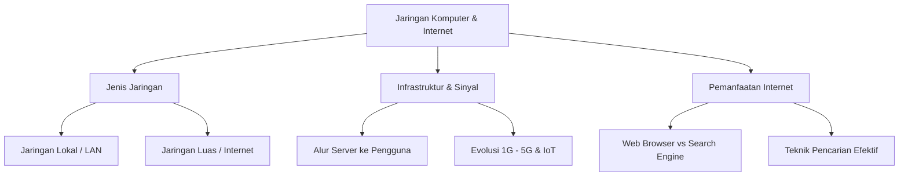
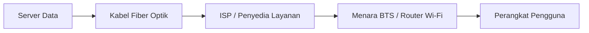

# Jaringan Komputer, Internet & Mesin Pencari

> **Kelas 7 • Semester 2 • Elemen: Literasi Digital • Alokasi Waktu: 12 JP**  
> **Tujuan Pembelajaran (TP 7.2.1):** Memahami konsep dasar internet serta pemanfaatannya, membedakan jaringan lokal dan internet, serta menggunakan mesin pencari untuk menemukan informasi secara efektif.  
> **Dimensi Profil Lulusan:** Mandiri, Bernalar Kritis.

---

## Peta Konsep



---

## 1. Pemantik: Mengapa Pesan Bisa Sampai dalam Hitungan Detik?

Pernahkah kamu mengirim pesan singkat ke teman yang berada di kota lain, atau membuka video pembelajaran di HP, lalu semuanya muncul hanya dalam hitungan detik? Padahal, komputer penyimpanan (*server*) tempat video itu berada bisa jadi terletak di negara lain yang jaraknya ribuan kilometer dari rumahmu.

Bagaimana mungkin data dari belahan dunia lain bisa berpindah secepat kedipan mata ke layar ponsel kita? Jawabannya terletak pada **jaringan komputer** dan **internet**. Di bab ini, kita akan membedah bagaimana jaringan bekerja dari ruang laboratorium sekolah hingga skala global, serta cara memanfaatkan mesin pencari secara cerdas.

---

## 2. Mengenal Jaringan Komputer: Lokal (LAN) vs Internet

**Jaringan komputer** adalah dua atau lebih perangkat (komputer, laptop, ponsel, printer) yang saling terhubung melalui media kabel maupun nirkabel (*wireless*) agar dapat bertukar data dan berbagi sumber daya.

Berdasarkan luas jangkauannya, jaringan komputer dibagi menjadi beberapa jenis utama:

1. **LAN (*Local Area Network*) — Jaringan Lokal**  
   Jaringan yang mencakup area sempit dan terbatas, seperti satu ruangan laboratorium komputer, satu gedung sekolah, atau rumah. Contoh paling dekat: seluruh komputer di lab sekolah yang terhubung ke satu *printer* bersama atau satu jaringan Wi-Fi lokal tanpa harus tersambung ke internet.
2. **MAN (*Metropolitan Area Network*)**  
   Jaringan yang jangkauannya lebih luas dari LAN, biasanya menghubungkan beberapa gedung dalam satu kota (misalnya jaringan antar-kantor dinas pemerintahan di Kota Solok).
3. **WAN (*Wide Area Network*)**  
   Jaringan berskala sangat luas yang menghubungkan antar-kota, antar-pulau, bahkan antar-negara.
4. **Internet (*Interconnected Network*)**  
   Jaringan global raksasa yang menghubungkan jutaan jaringan lokal (LAN, MAN, WAN) di seluruh dunia menjadi satu sistem komunikasi besar. Jika LAN diibaratkan jalan komplek perumahan, maka **internet adalah seluruh jaringan jalan raya, tol, dan jalur penerbangan yang menghubungkan semua kota di dunia**.

### Perbedaan Jaringan Lokal (LAN) dan Internet

| Aspek Perbandingan | Jaringan Lokal (LAN) | Internet |
| :--- | :--- | :--- |
| **Jangkauan Area** | Terbatas (ruangan, rumah, gedung sekolah). | Global (seluruh dunia). |
| **Kepemilikan & Pengelola** | Dimiliki dan dikelola sendiri (misalnya pihak sekolah atau pemilik rumah). | Tidak dimiliki satu pihak; dikelola bersama oleh berbagai organisasi dan penyedia layanan dunia. |
| **Kecepatan Transfer Data** | Sangat tinggi dan stabil karena jaraknya dekat. | Bergantung pada paket layanan, kualitas sinyal, dan kepadatan trafik. |
| **Biaya Operasional** | Cukup biaya pembelian perangkat (kabel, *switch*, *router*), tidak ada iuran kuota bulanan untuk transfer lokal. | Memerlukan biaya langganan (paket data seluler atau Wi-Fi bulanan ke ISP). |
| **Contoh Penggunaan** | Berbagi file di lab komputer, mencetak dokumen ke *printer* jaringan, ujian berbasis *server* lokal sekolah. | Mencari informasi di Google, mengirim email, rapat daring, mengakses media sosial. |

---

## 3. Bagaimana Internet Sampai ke Tangan Kita?

Banyak orang mengira internet "melayang di awan" karena ada istilah *cloud*. Faktanya, hampir seluruh lalu lintas internet dunia mengalir lewat infrastruktur fisik yang nyata—termasuk kabel serat optik yang dibentangkan di dasar laut!

Berikut perjalanan data dari tempat penyimpanan hingga tampil di layar HP atau laptopmu:



Penjelasan setiap komponennya:

* **Server Data:** Komputer berkemampuan sangat tinggi yang menyala 24 jam penuh untuk menyimpan halaman web, gambar, video, dan aplikasi.
* **Kabel Fiber Optik:** Kabel berbahan serat kaca halus yang mengirimkan data dalam bentuk **pulsa cahaya** dengan kecepatan sangat tinggi melintasi daratan dan dasar laut.
* **ISP (*Internet Service Provider*):** Perusahaan penyedia layanan internet yang menjadi "gerbang" bagi masyarakat untuk masuk ke jaringan internet global (contoh di Indonesia: Telkomsel/IndiHome, Indosat, XL, Biznet, dan lainnya).
* **Menara BTS (*Base Transceiver Station*) / Router Wi-Fi:** Perangkat pemancar terakhir yang mengubah sinyal dari ISP menjadi gelombang radio agar bisa ditangkap tanpa kabel oleh HP (melalui sinyal seluler dari BTS) atau laptop/HP (melalui sinyal Wi-Fi dari *router*).
* **Perangkat Pengguna (*Client*):** Ponsel, tablet, atau laptop yang kamu gunakan untuk meminta dan menampilkan informasi.

---

## 4. Evolusi Sinyal Seluler (1G hingga 5G) dan IoT

Cara perangkat seluler terhubung ke jaringan terus berkembang pesat dari generasi ke generasi. Huruf **"G"** pada 4G atau 5G adalah singkatan dari ***Generation*** (generasi teknologi jaringan nirkabel).

| Generasi | Kemampuan Utama | Gambaran di Kehidupan Nyata |
| :--- | :--- | :--- |
| **1G** | Hanya panggilan suara (sinyal analog). | Telepon genggam berukuran besar dengan antena panjang; belum bisa berkirim SMS. |
| **2G** | Suara digital + pesan teks (**SMS** dan **MMS**). | Mulai muncul ponsel layar kecil yang bisa berkirim pesan singkat dan internet sangat lambat (GPRS/EDGE). |
| **3G** | Akses internet *mobile* yang layak untuk membuka web dan *video call* awal. | Era awal *smartphone* dan media sosial di ponsel. |
| **4G (LTE)** | Internet berkecepatan tinggi dan stabil. | Lancar menonton video HD, kelas daring (*video conference*), dan bermain gim daring. |
| **5G** | Kecepatan sangat tinggi dengan jeda (*latency*) nyaris nol, mampu menampung jutaan perangkat sekaligus. | Mendukung teknologi modern seperti kendaraan otonom, operasi medis jarak jauh, dan kota pintar (*smart city*). |

### Mengenal *Internet of Things* (IoT)
Saat ini, internet tidak hanya menghubungkan komputer dan ponsel, tetapi juga **benda-benda di sekitar kita**. Konsep inilah yang disebut **IoT (*Internet of Things*)**—yaitu benda fisik yang dilengkapi sensor dan koneksi internet sehingga bisa mengirim data atau dikendalikan dari jarak jauh.

**Contoh IoT di sekitar kita:**
* **Jam tangan pintar (*smartwatch*):** Memantau detak jantung dan jumlah langkah lalu mengirim laporannya ke HP.
* **Lampu & AC pintar (*smart home*):** Dapat dinyalakan atau dimatikan lewat aplikasi ponsel meski pemilik rumah sedang di luar kota.
* **CCTV daring:** Memantau kondisi rumah atau sekolah secara langsung dari jarak jauh.
* **Sensor pertanian pintar:** Mengukur kelembapan tanah secara otomatis dan menyalakan penyiraman tanaman bila tanah mulai kering.

---

## 5. *Web Browser* vs *Search Engine* (Jangan Tertukar!)

Dua istilah ini paling sering tertukar dalam percakapan sehari-hari. Padahal fungsinya sangat berbeda:

| Aspek | *Web Browser* (Peramban Web) | *Search Engine* (Mesin Pencari) |
| :--- | :--- | :--- |
| **Pengertian** | **Aplikasi** yang terpasang di HP/komputer untuk membuka dan menampilkan halaman website. | **Website khusus** yang bertugas membantu kita mencari informasi di internet berdasarkan kata kunci. |
| **Analogi** | **Mobil / Kendaraan** yang mengantarmu berkeliling kota. | **Peta / Petugas Informasi** yang memberitahu alamat mana yang harus kamu tuju. |
| **Contoh** | Google Chrome, Mozilla Firefox, Microsoft Edge, Safari, Opera. | Google Search (`google.com`), Bing (`bing.com`), DuckDuckGo (`duckduckgo.com`), Yahoo Search. |

> 💡 **Ingat:** Kamu membutuhkan **Web Browser** terlebih dahulu untuk bisa membuka **Search Engine**.

### Mengenal Bagian Alamat Website (URL)
Saat membuka halaman di *browser*, kamu akan melihat alamat di bilah atas yang disebut **URL (*Uniform Resource Locator*)**. Contoh:

```text
[https://www.kemdikbud.go.id/berita](https://www.kemdikbud.go.id/berita)
```

* **`https://`** → Protokol keamanan pengiriman data. Huruf **`s`** (*secure*) menandakan koneksi terenkripsi dan lebih aman dibanding `http://`.
* **`kemdikbud.go.id`** → Nama **domain** (alamat unik website).
* **Akhiran Domain (*Extension*)** memberi petunjuk jenis pemilik situs:
  * `.sch.id` → Sekolah di Indonesia
  * `.ac.id` / `.edu` → Perguruan tinggi / pendidikan
  * `.go.id` / `.gov` → Lembaga pemerintahan resmi
  * `.org` → Organisasi nirlaba
  * `.com` / `.co.id` → Situs umum atau perusahaan komersial

---

## 6. Teknik Menggunakan Mesin Pencari Secara Efektif

Mengetik kalimat panjang seperti *"tolong carikan pengertian jaringan komputer kelas 7 lengkap"* sering kali memunculkan jutaan hasil yang kurang relevan. Agar pencarianmu tepat sasaran, cepat, dan akurat, terapkan **5 teknik pencarian cerdas** berikut:

### 1. Gunakan Kata Kunci Inti (Bukan Kalimat Panjang)
Buang kata sambung atau kata tanya yang tidak perlu.
* ❌ Kurang efektif: `apa saja contoh perangkat jaringan komputer untuk anak smp`
* ✅ Lebih efektif: `contoh perangkat jaringan komputer`

### 2. Tanda Kutip Ganda (`"..."`) untuk Pencarian Frasa Persis
Gunakan tanda kutip jika kamu ingin mencari susunan kata yang **sama persis** tanpa terpisah-pisah.
* Contoh: `"sejarah kota solok"` → Mesin pencari hanya menampilkan halaman yang memuat frasa *sejarah kota solok* secara utuh.

### 3. Tanda Minus (`-`) untuk Mengecualikan Kata
Gunakan tanda minus (tanpa spasi sebelum kata) untuk membuang hasil yang tidak diinginkan.
* Contoh: `jaguar -mobil` → Menampilkan informasi tentang hewan jaguar tanpa memunculkan iklan atau berita mobil merek Jaguar.

### 4. Operator `site:` untuk Mencari di Situs Tertentu Saja
Sangat berguna saat mengerjakan tugas sekolah agar sumbernya langsung berasal dari lembaga resmi atau situs pendidikan.
* Contoh: `literasi digital site:kemdikbud.go.id` → Hanya mencari materi literasi digital yang diterbitkan di situs resmi Kemdikbud.

### 5. Operator `filetype:` untuk Mencari Format File Tertentu
Gunakan bila kamu membutuhkan bahan bacaan dalam bentuk dokumen PDF atau presentasi PPT.
* Contoh: `modul jaringan komputer filetype:pdf` → Hanya menampilkan dokumen berformat PDF yang bisa langsung dibaca atau diunduh.

---

## 7. Cek Pemahaman & Latihan Mandiri

Kerjakan soal-soal berikut terlebih dahulu sebelum membuka kunci pembahasannya!

### Latihan 1: Studi Kasus Infrastruktur
Di laboratorium komputer sekolah, seluruh 20 komputer siswa dapat saling mengirim file ke komputer guru dan mencetak ke satu *printer* yang sama, meskipun kabel internet dari ISP sedang putus.  
**Pertanyaan:** Jenis jaringan apa yang sedang berjalan di laboratorium tersebut? Jelaskan alasannya!

<details>
<summary><strong>👉 Klik untuk melihat pembahasan Latihan 1</strong></summary>

Jaringan yang berjalan adalah **LAN (*Local Area Network*)** atau jaringan lokal. Alasannya, seluruh perangkat berada di area terbatas (satu ruangan laboratorium) dan tetap bisa berkomunikasi serta berbagi *printer* secara internal tanpa memerlukan sambungan internet global dari ISP.

</details>

### Latihan 2: Praktik Kata Kunci Cerdas
Rina mendapat tugas mencari **modul berbentuk PDF** tentang **keamanan internet** yang berasal langsung dari **situs resmi pemerintahan Indonesia (`.go.id`)**.  
**Pertanyaan:** Tuliskan satu baris kata kunci pencarian paling efektif yang sebaiknya diketik Rina di mesin pencari!

<details>
<summary><strong>👉 Klik untuk melihat pembahasan Latihan 2</strong></summary>

Rina dapat mengetikkan kombinasi operator berikut:
```text
"keamanan internet" site:go.id filetype:pdf
```
**Penjelasan:**
* `"keamanan internet"` memastikan frasa tersebut muncul utuh.
* `site:go.id` membatasi hasil hanya dari situs resmi pemerintah Indonesia.
* `filetype:pdf` menyaring hasil agar hanya menampilkan dokumen PDF.

</details>

### Latihan 3: Benar atau Salah?
Tentukan apakah pernyataan di bawah ini **Benar** atau **Salah**:
1. Google Chrome dan Mozilla Firefox adalah contoh *Search Engine*.
2. Kabel fiber optik mengirimkan data internet menggunakan pulsa cahaya.
3. Jam tangan pintar yang mengirim data detak jantung ke aplikasi HP termasuk contoh *Internet of Things* (IoT).

<details>
<summary><strong>👉 Klik untuk melihat pembahasan Latihan 3</strong></summary>

1. **Salah.** Google Chrome dan Mozilla Firefox adalah ***Web Browser*** (peramban web), bukan *Search Engine*.
2. **Benar.** Fiber optik memanfaatkan serat kaca dan pulsa cahaya sehingga pengiriman data sangat cepat.
3. **Benar.** Perangkat fisik yang memiliki sensor dan terhubung ke internet untuk bertukar data merupakan penerapan IoT.

</details>

---

## 8. Glosarium Istilah Penting

* **BTS (*Base Transceiver Station*):** Menara pemancar dan penerima sinyal seluler yang menghubungkan perangkat pengguna ke jaringan operator.
* **Domain:** Nama alamat unik sebuah website yang mudah diingat manusia (contoh: `kemdikbud.go.id`).
* **Fiber Optik:** Kabel berbahan serat kaca/plastik sangat halus yang menghantarkan data dalam bentuk cahaya.
* **IoT (*Internet of Things*):** Konsep perangkat fisik sehari-hari yang dilengkapi sensor dan koneksi internet.
* **ISP (*Internet Service Provider*):** Perusahaan penyedia jasa layanan sambungan internet.
* **LAN (*Local Area Network*):** Jaringan komputer yang mencakup area terbatas seperti satu ruangan atau gedung.
* **Search Engine:** Layanan situs web untuk menemukan informasi di internet menggunakan kata kunci.
* **Web Browser:** Perangkat lunak aplikasi untuk membuka dan menampilkan halaman web.

---

## 9. Rangkuman

* **Jaringan Lokal (LAN)** menghubungkan perangkat di area sempit secara mandiri, sedangkan **Internet** adalah jaringan global yang menyatukan jutaan jaringan di seluruh dunia.
* Data internet mengalir melalui infrastruktur nyata: **Server → Kabel Fiber Optik → ISP → Menara BTS / Router Wi-Fi → Perangkat Pengguna**.
* Teknologi jaringan seluler berkembang dari **1G** (hanya suara) hingga **5G** (kecepatan sangat tinggi yang mendukung **IoT**).
* ***Web Browser*** adalah aplikasi pembuka web (Chrome, Firefox, Edge), sedangkan ***Search Engine*** adalah situs pencari informasi (Google, Bing, DuckDuckGo).
* Pencarian informasi akan jauh lebih cepat dan akurat jika menggunakan kata kunci inti serta operator pencarian seperti **`"..."`**, **`-`**, **`site:`**, dan **`filetype:`**.