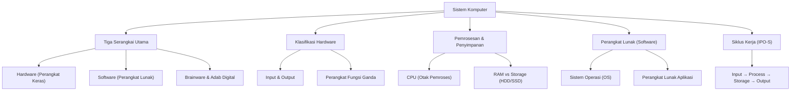
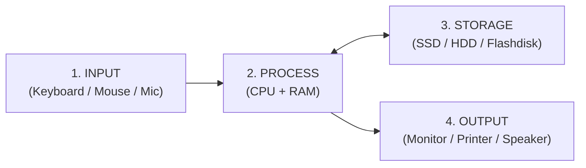

# BAB I: Sistem Komputer

> **Kelas 7 • Semester 1 • Elemen: Literasi Digital • Alokasi Waktu: 18 JP**  
> **Tujuan Pembelajaran:** Mendeskripsikan komponen dasar sistem komputer (*Hardware*, *Software*, dan *Brainware*), menjelaskan fungsi CPU, memori, *storage*, serta perangkat masukan/keluaran (termasuk perangkat fungsi ganda), membedakan peran sistem operasi dan aplikasi, serta menganalisis siklus pengolahan data (IPO-S).  
> **Dimensi Profil Lulusan:** Mandiri, Bernalar Kritis.

---

## Peta Konsep Bab Ini

---

## 1. Pemantik: Belajar dari Kesempurnaan Ciptaan Allah

*Bismillahirrahmaanirrahiim.*

Allah *Subhanahu wa Ta'ala* menciptakan manusia dalam bentuk yang sebaik-baiknya. Kita dianugerahi tubuh fisik untuk bergerak, akal dan ruh untuk berpikir serta merasakan, dan tujuan hidup untuk beribadah serta memberi manfaat di muka bumi.

Terinspirasi dari harmoni tersebut, manusia merancang sebuah mesin bantu kerja bernama **Komputer**. Mengapa komputer disebut sebagai sebuah **sistem**? Karena komputer bukanlah satu benda tunggal yang bisa bekerja sendirian, melainkan **kumpulan dari beberapa komponen berbeda yang saling terhubung dan bekerja sama** untuk mengolah data menjadi informasi yang bermanfaat.

Jika salah satu komponen utamanya hilang atau rusak, sistem komputer tidak akan dapat menjalankan tugasnya.

---

## 2. Tiga Serangkai Sistem Komputer

Agar komputer dapat menyala, menerima perintah, dan menghasilkan karya, diperlukan kesatuan **Tiga Serangkai** berikut:

1. **Hardware (Perangkat Keras):**  
   Seluruh komponen fisik komputer yang dapat **dilihat wujudnya, disentuh, dan memiliki massa/berat**. Ibarat tubuh manusia, *hardware* adalah raga komputer. Contoh: layar monitor, *keyboard*, *mouse*, *printer*, dan unit mesin utama.
2. **Software (Perangkat Lunak):**  
   Kumpulan instruksi, program, atau data digital yang tersimpan di dalam komputer. *Software* tidak berwujud fisik seperti benda padat, tetapi dapat dilihat tampilannya di layar dan berfungsi memberi "nyawa" serta kecerdasan agar *hardware* tahu apa yang harus dikerjakan. Contoh: Windows, Android, Google Docs, dan Google Chrome.
3. **Brainware (Pengguna / Sumber Daya Manusia):**  
   Manusia yang mengoperasikan, merancang, memprogram, dan memelihara sistem komputer. Tanpa *brainware*, komputer tercanggih sekalipun hanyalah benda diam tanpa arah.

> 💡 **Analogi Pengikat:** Membeli laptop mahal (*Hardware*) tanpa menginstal program (*Software*) membuat laptop itu tidak bisa dipakai menulis. Sebaliknya, program hebat (*Software*) tidak akan berjalan tanpa mesin (*Hardware*). Dan keduanya membutuhkan manusia (*Brainware*) yang mengendalikannya dengan niat yang baik.

### Mengenal Beragam Profesi dan Peran *Brainware*
Tidak semua pengguna komputer memiliki tugas yang sama. Dalam dunia teknologi informasi, *brainware* terbagi ke dalam beberapa peran utama:

| Peran *Brainware* | Tugas Utama | Contoh di Kehidupan Nyata |
| :--- | :--- | :--- |
| **Operator** | Menggunakan perangkat lunak yang sudah tersedia untuk menyelesaikan pekerjaan rutin sehari-hari. | Siswa yang mengetik tugas di Google Docs, staf tata usaha yang menginput nilai, atau kasir toko. |
| **Programmer** | Menulis kode bahasa pemrograman untuk menciptakan, mengembangkan, dan memperbaiki *software* atau aplikasi. | Pembuat aplikasi pembelajaran, pengembang gim edukasi, atau pembuat situs web. |
| **System Analyst** | Menganalisis kebutuhan pengguna dan merancang arsitektur sistem komputer secara menyeluruh sebelum dibuat oleh *programmer*. | Perancang sistem informasi akademik sekolah atau sistem layanan rumah sakit. |
| **Technician (Teknisi)** | Merakit, merawat, mendiagnosis kerusakan, dan memperbaiki komponen *hardware* maupun jaringan komputer. | Teknisi yang memperbaiki laptop rusak atau memasang jaringan kabel di lab sekolah. |

### Adab dan Etika Sebagai *Khalifah* Digital
Dalam Islam, manusia memikul amanah sebagai *khalifah* (pengelola) di bumi. Saat menjadi *brainware*, kendalikan teknologi dengan **adab digital**:
* Menggunakan komputer dan internet untuk menuntut ilmu dan hal-hal yang bermanfaat.
* Tidak menyakiti orang lain melalui tulisan atau komentar (*cyberbullying*) serta tidak menyebarkan kabar bohong (hoaks).
* Menjaga kesehatan amanah tubuh (mata, postur duduk, dan waktu istirahat) dengan tidak menatap layar secara berlebihan.

---

## 3. Mengenal Perangkat Keras (*Hardware*) Secara Mendalam

> ❌ **Miskonsepsi yang Sering Terjadi:** Banyak orang menyebut kotak besar di samping monitor komputer meja (*desktop*) sebagai **"CPU"**.  
> ✅ **Faktanya:** Kotak besar itu bernama **System Unit / Casing**. Di dalamnya terdapat papan sirkuit utama (*Motherboard*), catu daya (*Power Supply*), kipas pendingin, RAM, *storage*, dan sebuah chip kecil persegi yang barulah merupakan **CPU** sesungguhnya.

### A. Perbedaan Bentuk Komputer Desktop dan Laptop
* **Komputer Desktop (Komputer Meja):** Komponen utamanya terpisah-pisah (*System Unit/Casing*, monitor, *keyboard*, *mouse*) dan dihubungkan melalui kabel ke lubang colokan (**Port**) seperti **USB** (untuk *keyboard/mouse/flashdisk*), **HDMI/VGA** (untuk layar monitor/proyektor), **Audio Jack** (untuk *speaker/headset*), dan **Port Power** (listrik).
* **Laptop / Notebook:** Seluruh komponen (*casing* mesin, layar, *keyboard*, *touchpad*, baterai, *speaker*, dan kamera) dirancang ringkas menyatu dan dapat dilipat sehingga mudah dibawa.

### B. Klasifikasi Perangkat Keras Berdasarkan Fungsinya

#### 1. Perangkat Masukan (*Input Device*)
Alat untuk **memasukkan data atau perintah** dari manusia ke dalam komputer:
* **Keyboard:** Memasukkan huruf, angka, simbol, dan pintasan perintah.
* **Mouse / Touchpad:** Menggerakkan kursor, menunjuk, dan memilih objek di layar.
* **Microphone:** Memasukkan data berupa gelombang suara.
* **Scanner (Pemindai):** Mengubah dokumen atau foto cetak di kertas menjadi file gambar/PDF digital di komputer.
* **Webcam / Kamera:** Memasukkan citra visual atau video secara langsung.

#### 2. Perangkat Keluaran (*Output Device*)
Alat untuk **menampilkan atau mengeluarkan hasil** pengolahan komputer agar dapat ditangkap indra manusia:
* **Monitor:** Menampilkan informasi visual (teks, gambar, video) di layar.
* **Printer:** Mencetak dokumen atau gambar digital ke atas media kertas.
* **Speaker / Earphone:** Mengeluarkan hasil pengolahan berupa suara.
* **Projector (Proyektor):** Memancarkan tampilan layar komputer ke permukaan layar lebar atau dinding kelas.

#### 3. Perangkat Keras Fungsi Ganda (Input sekaligus Output)
Beberapa perangkat modern dirancang memiliki **dua fungsi sekaligus**—dapat menerima masukan dari pengguna sekaligus mengeluarkan hasil dari komputer:

| Nama Perangkat | Peran Sebagai *Input* | Peran Sebagai *Output* |
| :--- | :--- | :--- |
| **Layar Sentuh (*Touchscreen*)** | Menerima perintah sentuhan dan geseran jari pengguna (menggantikan *mouse*). | Menampilkan gambar, teks, dan video ke mata pengguna (fungsi monitor). |
| **Headset (dengan Mikrofon)** | Merekam suara pengguna melalui mikrofon kecilnya. | Memperdengarkan suara dari komputer ke telinga pengguna. |
| **Printer All-in-One (Multifungsi)** | Memindai (*scan*) dokumen fisik menjadi file digital. | Mencetak dokumen digital ke kertas (*print*). |
| **Flashdisk / Kartu Memori** | Membaca data yang tersimpan untuk dimasukkan ke memori komputer. | Menyimpan data hasil olahan dari komputer ke dalamnya. |

---

## 4. Jantung dan Ingatan Komputer: CPU, RAM, dan Storage

Di dalam *System Unit* atau bodi laptop, terdapat tiga komponen vital yang menentukan seberapa cepat dan banyak pekerjaan yang dapat ditangani komputer:

### 1. CPU (*Central Processing Unit*) — Otak Komputer
**CPU** (sering disebut *Processor*) adalah chip utama yang bertugas **menghitung, membandingkan logika, dan menjalankan seluruh instruksi** dari perangkat lunak. Di dalam CPU terdapat bagian hitung dan logika (**ALU** — *Arithmetic Logic Unit*) serta bagian pengendali lalu lintas instruksi (**CU** — *Control Unit*). Semakin cepat kerja CPU, semakin sigap komputer menyelesaikan perhitungan rumit.

### 2. RAM (*Random Access Memory*) — Ingatan Jangka Pendek
**RAM** adalah memori kerja sementara yang menyimpan data dan aplikasi **yang sedang aktif dibuka saat ini**.
* **Analogi Meja Belajar:** Bayangkan RAM sebagai **permukaan meja belajarmu**. Semakin luas mejanya, semakin banyak buku dan alat tulis yang bisa kamu buka bersamaan tanpa berdesakan (komputer tidak mudah *lag*/macet).
* **Sifat *Volatile* (Sementara):** Saat jam belajar selesai—atau saat listrik padam dan komputer mati—semua yang berada di atas meja dibersihkan. Data di dalam RAM yang belum disimpan (*Save*) akan **hilang**.

### 3. Storage (Media Penyimpanan) — Ingatan Jangka Panjang
**Storage** adalah tempat menyimpan seluruh sistem operasi, aplikasi, dokumen, foto, dan video secara **permanen** (*Non-volatile*).
* **Analogi Lemari Arsip:** Bayangkan *Storage* sebagai **lemari buku tertutup**. Meskipun ruangan gelap atau listrik mati, semua buku yang sudah kamu masukkan ke dalam lemari tetap tersimpan aman untuk dibuka kembali keesokan harinya.

#### Perbandingan Jenis Media Penyimpanan (*Storage*)

| Jenis *Storage* | Cara Kerja & Ciri Fisik | Kecepatan | Ketahanan Guncangan |
| :--- | :--- | :--- | :--- |
| **HDD (*Hard Disk Drive*)** | Menggunakan piringan cakram magnetik yang berputar secara mekanis. | Lebih lambat saat membuka aplikasi besar. | Rentan rusak jika laptop terjatuh atau terguncang keras saat menyala. |
| **SSD (*Solid State Drive*)** | Menggunakan chip memori elektronik tanpa komponen bergerak. | Sangat cepat (menyalakan komputer hanya hitungan detik). | Jauh lebih tahan guncangan dan hemat daya listrik. |
| **Flashdisk / MicroSD** | Penyimpanan portabel berbasis chip berukuran ringkas. | Sedang hingga cepat (tergantung versi USB). | Praktis dibawa berpindah antar-perangkat untuk memindahkan data. |

---

## 5. Perangkat Lunak (*Software*): Sistem Operasi vs Aplikasi

Saat kamu menekan tombol **Power** pada komputer atau ponsel, komputer melakukan proses persiapan awal (*booting*) sebelum siap dipakai. Pada tahap inilah dua jenis perangkat lunak utama bekerja sesuai tugasnya:

| Aspek Pembeda | Sistem Operasi (*Operating System / OS*) | Perangkat Lunak Aplikasi (*Application Software*) |
| :--- | :--- | :--- |
| **Tugas Utama** | Mengelola seluruh sumber daya *hardware*, mengatur lalu lintas data, menyediakan tampilan antarmuka dasar, dan menjadi landasan berjalannya program lain. | Membantu pengguna menyelesaikan tugas spesifik tertentu (mengetik surat, menghitung tabel, menggambar, atau menjelajah web). |
| **Analogi** | **Polisi Lalu Lintas** atau **Pondasi & Bangunan Rumah**. | **Perabotan di Dalam Rumah** (kompor untuk memasak, meja untuk belajar). |
| **Ketergantungan** | **Wajib ada pertama kali.** Tanpa OS, komputer tidak bisa dioperasikan oleh pengguna biasa. | **Opsional sesuai kebutuhan**, dan hanya bisa diinstal jika OS sudah terpasang. |
| **Contoh** | **Komputer:** Windows, macOS, Linux. **Ponsel/Tablet:** Android, iOS. | **Pengolah Kata:** Google Docs, Microsoft Word. **Pengolah Angka:** Google Sheets, Excel. **Presentasi:** Google Slides, PowerPoint, Canva. **Browser:** Google Chrome, Mozilla Firefox. |

> 🔧 **Tahukah Kamu? (Mengenal *Driver*):**  
> Saat kamu mencolokkan *printer* baru ke laptop, terkadang komputer meminta instalasi ***Driver***. *Driver* adalah perangkat lunak penerjemah kecil yang membantu **Sistem Operasi** mengenali dan mengendalikan **perangkat keras baru** tersebut.

---

## 6. Siklus Pengolahan Data (IPO-S)

Setiap kali kamu menggunakan komputer—mulai dari menghitung di kalkulator hingga mengetik tugas—komputer selalu bekerja mengikuti alur berurutan yang disebut **Siklus IPO-S (*Input – Process – Output – Storage*)**:

### Contoh Penelusuran Siklus IPO-S: Menghitung `125 × 8`
1. **Input:** Kamu menekan tombol `1`, `2`, `5`, `×`, `8`, `=` pada *keyboard*. Sinyal perintah dikirim masuk ke komputer.
2. **Process:** **RAM** menampung angka sementara tersebut, lalu **CPU** menghitung operasi perkalian sesuai instruksi aplikasi kalkulator dan menghasilkan angka `1000`.
3. **Output:** Hasil angka `1000` dikirimkan ke layar **Monitor** sehingga dapat langsung kamu baca.
4. **Storage (Opsional/Jika Disimpan):** Jika hasil hitungan tersebut kamu ketik di dokumen lalu menekan tombol **Save**, data akan dikirim dari RAM ke **SSD/Harddisk** agar tidak hilang saat komputer dimatikan.

---

## 7. Aktivitas Pembelajaran (Plugged & Unplugged)

### Aktivitas 1: Permainan Kartu "Tiga Serangkai & IPO-S" (*Unplugged*)
1. Bentuk kelompok beranggotakan 4–5 orang.
2. Guru menyediakan kartu bertuliskan nama benda/peran (misalnya: *Scanner, Windows 11, Programmer, Speaker, Touchscreen, SSD, Google Chrome, Teknisi, RAM, Headset*).
3. **Misi 1:** Kelompokkan kartu ke dalam kategori **Hardware**, **Software**, dan **Brainware**.
4. **Misi 2:** Khusus kartu *Hardware*, pisahkan mana yang murni **Input**, murni **Output**, **Process/Storage**, dan mana yang termasuk **Perangkat Fungsi Ganda**.

### Aktivitas 2: Cek Spesifikasi "Jeroan" Komputer (*Plugged*)
1. Pada komputer Windows, klik kanan ikon **This PC** (atau buka **Settings → System → About**). Pada HP Android, buka **Setelan → Tentang Ponsel**.
2. Catat informasi berikut di buku catatanmu:
   * Nama **Sistem Operasi** dan versinya.
   * Jenis/merek **Prosesor (CPU)**.
   * Kapasitas **RAM** (misalnya: 8 GB).
   * Kapasitas **Storage** (misalnya: 256 GB SSD).

### Aktivitas 3: Simulasi Peran "Manusia Komputer" (*Unplugged*)
Simulasikan penjumlahan $35 + 45$ menggunakan 5 siswa: **User (Brainware)**, **Keyboard (Input)**, **RAM (Meja Sementara)**, **CPU (Penghitung)**, dan **Monitor (Output)**. Amati apa yang terjadi jika siswa yang berperan sebagai **RAM** diminta menjatuhkan kertas datanya sebelum **CPU** selesai menghitung!

---

## 8. Cek Pemahaman Bertingkat (Latihan Mandiri)

Kerjakan soal-soal di bawah ini terlebih dahulu di buku catatanmu sebelum membuka bagian pembahasan.

### Soal 1 (Pemahaman Konsep — Tiga Serangkai)
Ayah baru saja membeli sebuah *printer* baru untuk kebutuhan kerja di rumah. Kabel listrik dan kabel USB sudah terpasang rapi ke laptop, tetapi saat ayah menekan tombol cetak, muncul pesan peringatan bahwa perangkat belum dikenali dan *software* penghubungnya belum terpasang. Komponen sistem komputer apa yang belum lengkap pada kasus tersebut? Jelaskan!

<strong>👉 Klik untuk melihat pembahasan Soal 1</strong>

Komponen yang belum lengkap adalah **Software** (khususnya perangkat lunak ***driver* printer**). Meskipun *Hardware* (laptop dan *printer*) serta *Brainware* (ayah) sudah ada, komputer membutuhkan perangkat lunak penerjemah (*driver*) agar Sistem Operasi dapat berkomunikasi dan memberi perintah cetak ke *printer* tersebut.

### Soal 2 (Analisis Kasus — RAM vs Storage)
Fatimah sedang mengetik tugas rangkuman sepanjang dua halaman di komputer laboratorium sekolah. Tiba-tiba aliran listrik padam dan komputer langsung mati mendadak sebelum Fatimah sempat menekan tombol **Save**. Saat listrik menyala kembali, seluruh ketikannya hilang. Jelaskan mengapa hal tersebut terjadi dengan menghubungkan konsep **RAM** dan **Storage**!

<strong>👉 Klik untuk melihat pembahasan Soal 2</strong>

Selama dokumen masih diketik dan belum disimpan (*Save*), data tulisan hanya berada di dalam **RAM** yang bersifat sementara (*volatile* — membutuhkan aliran listrik untuk mempertahankan data). Karena listrik padam sebelum data dipindahkan ke **Storage** (SSD/Harddisk yang bersifat permanen), seluruh isi RAM langsung terhapus saat komputer mati.

### Soal 3 (Klasifikasi — Perangkat Fungsi Ganda)
Perhatikan daftar perangkat berikut: *(1) Keyboard, (2) Layar Sentuh Ponsel, (3) Speaker, (4) Headset dengan Mikrofon, (5) Proyektor*. Manakah perangkat yang memiliki **fungsi ganda (Input sekaligus Output)**? Jelaskan kedua fungsinya!

<strong>👉 Klik untuk melihat pembahasan Soal 3</strong>

Perangkat yang memiliki fungsi ganda adalah **(2) Layar Sentuh Ponsel** dan **(4) Headset dengan Mikrofon**:
* **Layar Sentuh Ponsel:** Berfungsi sebagai **Input** saat menerima sentuhan/ketukan jari untuk memberi perintah, dan berfungsi sebagai **Output** saat menampilkan tampilan visual di layar.
* **Headset dengan Mikrofon:** Berfungsi sebagai **Input** saat menangkap suara pengguna lewat mikrofon, dan berfungsi sebagai **Output** saat mengeluarkan suara ke telinga pengguna.

### Soal 4 (Analisis Peran — Profesi Brainware)
Sebuah sekolah ingin membangun aplikasi rapor digital baru. **Pak Budi** bertugas mewawancarai wali kelas dan merancang alur sistem rapor tersebut, **Ibu Rina** menerjemahkan rancangan tersebut menjadi baris kode aplikasi, **Kak Dani** memperbaiki komputer tata usaha yang rusak akibat korsleting, dan **Bu Sari** menginput nilai siswa ke dalam aplikasi yang sudah jadi. Tentukan peran *brainware* masing-masing tokoh tersebut!

<strong>👉 Klik untuk melihat pembahasan Soal 4</strong>

* **Pak Budi:** *System Analyst* (menganalisis kebutuhan dan merancang alur sistem).
* **Ibu Rina:** *Programmer* (menulis kode program untuk membangun aplikasi).
* **Kak Dani:** *Technician* / Teknisi (memperbaiki kerusakan perangkat keras komputer).
* **Bu Sari:** *Operator* (menggunakan aplikasi yang sudah jadi untuk pekerjaan harian).

### Soal 5 (HOTS — Peran Sistem Operasi)
Sebuah laptop memiliki spesifikasi *hardware* yang sangat tinggi (prosesor terbaru, RAM 16 GB, SSD 512 GB), namun kapasitas *storage*-nya benar-benar kosong karena belum diinstal **Sistem Operasi (OS)** apa pun. Apa yang akan terjadi saat pengguna menekan tombol *Power*, dan bisakah pengguna langsung menginstal aplikasi pengolah kata di laptop tersebut? Jelaskan alasanmu!

<strong>👉 Klik untuk melihat pembahasan Soal 5</strong>

Saat tombol *Power* ditekan, layar hanya akan menampilkan pesan kesalahan sistem tidak ditemukan (seperti *"No Bootable Device"* atau masuk ke pengaturan dasar BIOS) dan laptop **tidak dapat masuk ke tampilan desktop**. Pengguna **tidak bisa langsung menginstal aplikasi pengolah kata** karena aplikasi membutuhkan **Sistem Operasi** sebagai fondasi pengelola perangkat keras dan antarmuka dasar untuk berjalan.

---

## 9. Glosarium Istilah Penting

* **Brainware:** Manusia yang mengoperasikan, merancang, memprogram, atau merawat sistem komputer.
* **CPU (*Central Processing Unit*):** Chip utama di dalam komputer yang berfungsi sebagai otak pemroses perhitungan dan pengendali instruksi.
* **Driver:** Perangkat lunak kecil yang menghubungkan Sistem Operasi dengan perangkat keras tertentu agar dapat dikenali dan digunakan.
* **Hardware:** Komponen fisik komputer yang tampak dan dapat disentuh secara langsung.
* **HDD (*Hard Disk Drive*):** Media penyimpanan permanen yang menggunakan piringan cakram magnetik berputar.
* **Input Device:** Perangkat keras yang digunakan untuk memasukkan data atau perintah ke dalam komputer.
* **IPO-S (*Input – Process – Output – Storage*):** Siklus dasar cara kerja komputer dalam mengolah data.
* **Output Device:** Perangkat keras yang menampilkan atau mengeluarkan hasil pengolahan data kepada pengguna.
* **RAM (*Random Access Memory*):** Memori penyimpanan sementara (*volatile*) untuk menampung data dan program yang sedang aktif dijalankan.
* **Sistem Operasi (*Operating System*):** Perangkat lunak utama yang mengelola seluruh kerja perangkat keras dan menjadi landasan berjalannya aplikasi lain.
* **Software:** Perangkat lunak berupa program atau instruksi digital yang mengatur kerja komputer.
* **SSD (*Solid State Drive*):** Media penyimpanan permanen berbasis chip elektronik yang bekerja jauh lebih cepat dan tahan guncangan dibanding HDD.
* **Storage:** Media penyimpanan data jangka panjang (*non-volatile*) yang tetap menyimpan data meskipun komputer dimatikan.

---

## 10. Rangkuman Bab

* **Sistem komputer** hanya dapat berfungsi apabila ketiga komponen utamanya—***Hardware*, *Software*, dan *Brainware***—hadir dan bekerja sama secara selaras.
* ***Brainware*** memiliki beragam peran sesuai keahliannya (**Operator, Programmer, System Analyst, dan Technician**) serta wajib menjaga adab dan etika dalam memanfaatkan teknologi.
* ***Hardware*** terbagi menjadi perangkat **Input**, **Output**, **Pemroses/Penyimpan**, serta **Perangkat Fungsi Ganda** (seperti *touchscreen*, *headset*, dan *printer all-in-one*).
* **CPU** berperan sebagai otak pemroses, **RAM** sebagai ruang kerja sementara (*volatile*), dan **Storage** (HDD/SSD/Flashdisk) sebagai tempat penyimpanan permanen (*non-volatile*).
* **Sistem Operasi** adalah perangkat lunak fondasi yang mengendalikan mesin, sedangkan **Perangkat Lunak Aplikasi** adalah alat bantu khusus untuk menyelesaikan pekerjaan pengguna melalui siklus **IPO-S**.