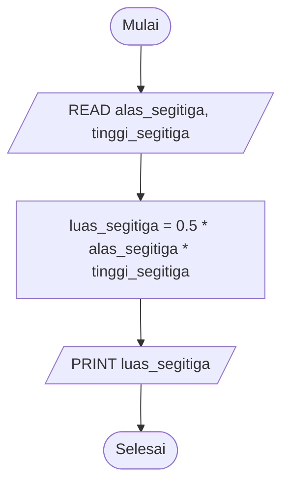

# Algoritma & Notasi Pseudocode

> **Kelas 8 • Semester 2 • Elemen: Berpikir Komputasional**  
> **Tujuan Pembelajaran:** Merancang urutan instruksi logis dalam format *pseudocode* untuk menyelesaikan masalah sederhana.

---

## 1. Pemantik: Dari Rumus Matematika ke Bahasa Komputer
Saat pelajaran Matematika, jika kamu diminta menghitung luas persegi panjang, kamu sudah hafal rumusnya:

$$L = p \times l$$

Bagi manusia, rumus singkat itu sudah cukup jelas. Namun, komputer tidak bisa langsung menebak angka berapa yang menjadi $p$ dan $l$, serta apa yang harus dilakukan setelah hasil hitungannya ketemu. Komputer membutuhkan **urutan langkah yang rinci, logis, dan tidak membingungkan**. Urutan langkah inilah yang disebut **Algoritma**.

---

## 2. Mengenal Pola Kerja Komputer (IPO)
Sebelum menulis *pseudocode*, biasakan memecah masalah menjadi tiga bagian (**IPO**):

| Tahap | Penjelasan | Contoh pada Luas Persegi Panjang |
| :--- | :--- | :--- |
| **Input** (Masukan) | Data yang harus diberikan ke komputer | Nilai `panjang` dan `lebar` |
| **Process** (Proses) | Perhitungan atau pengolahan data | Mengalikan `panjang` dengan `lebar` |
| **Output** (Keluaran) | Hasil akhir yang ditampilkan | Nilai `luas_persegi_panjang` |

### Aturan Penamaan Variabel
Variabel adalah "wadah" untuk menyimpan nilai. Agar rapi dan konsisten:
* Gunakan huruf kecil yang jelas maknanya (hindari hanya 1 huruf seperti `x` atau `y` jika bisa diperjelas).
* **Tidak boleh ada spasi.** Jika nama variabel terdiri dari lebih dari satu kata, sambungkan dengan tanda garis bawah (`_`), misalnya: `luas_persegi_panjang`, `alas_segitiga`, atau `total_bayar`.

---

## 3. Menulis Notasi Pseudocode
*Pseudocode* adalah cara menuliskan algoritma menggunakan kosakata terbatas yang menyerupai bahasa pemrograman, tetapi tetap mudah dibaca manusia.

Kosakata dasar yang kita gunakan:
* `ALGORITMA` → Judul langkah penyelesaian masalah.
* `READ` → Meminta atau membaca data masukan (*input*) ke dalam variabel.
* `=` → Menyimpan hasil perhitungan ke dalam variabel.
* `PRINT` → Menampilkan hasil akhir (*output*) ke layar.

### Contoh Kasus 1: Menghitung Luas Persegi Panjang
**Rumus Matematika:**
$$L = p \times l$$

**Bentuk Pseudocode:**
```text
ALGORITMA hitung_luas_persegi_panjang
READ panjang
READ lebar
luas_persegi_panjang = panjang * lebar
PRINT luas_persegi_panjang
```

---

### Contoh Kasus 2: Menghitung Luas Segitiga
**Rumus Matematika:**
$$L = \frac{1}{2} \times a \times t$$

**Pemetaan IPO:**
* **Input:** `alas_segitiga`, `tinggi_segitiga`
* **Process:** `luas_segitiga = 0.5 * alas_segitiga * tinggi_segitiga`
* **Output:** `luas_segitiga`

**Bentuk Pseudocode:**
```text
ALGORITMA hitung_luas_segitiga
READ alas_segitiga
READ tinggi_segitiga
luas_segitiga = 0.5 * alas_segitiga * tinggi_segitiga
PRINT luas_segitiga
```

**Bentuk Diagram Alir (Flowchart):**


---

## 4. Latihan Mandiri
Coba kerjakan dulu di buku catatanmu sebelum membuka pembahasan.

**Soal:**  
Sebuah taman berbentuk persegi memiliki panjang sisi $s$. Diketahui rumus keliling persegi adalah $K = 4 \times s$.  
Rancanglah *pseudocode* untuk menghitung keliling taman tersebut dengan menggunakan nama variabel `panjang_sisi` dan `keliling_persegi`.

<details>
<summary><strong>👉 Klik di sini untuk melihat pembahasan</strong></summary>

1. **Input:** `panjang_sisi`
2. **Process:** `keliling_persegi = 4 * panjang_sisi`
3. **Output:** `keliling_persegi`

```text
ALGORITMA hitung_keliling_persegi
READ panjang_sisi
keliling_persegi = 4 * panjang_sisi
PRINT keliling_persegi
```
</details>

---

## 5. Rangkuman
* **Algoritma** adalah urutan langkah logis dan sistematis untuk menyelesaikan suatu masalah.
* Menyusun algoritma lebih mudah jika dimulai dari memetakan **Input → Process → Output**.
* ***Pseudocode*** menuliskan algoritma dengan kosakata terbatas (`READ`, `PRINT`, dan operasi matematika) serta penamaan variabel tanpa spasi menggunakan garis bawah (`_`).